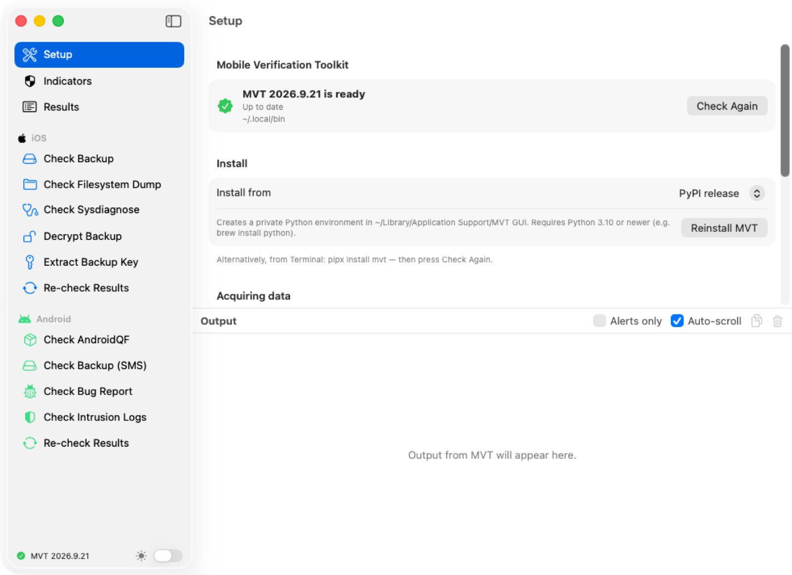
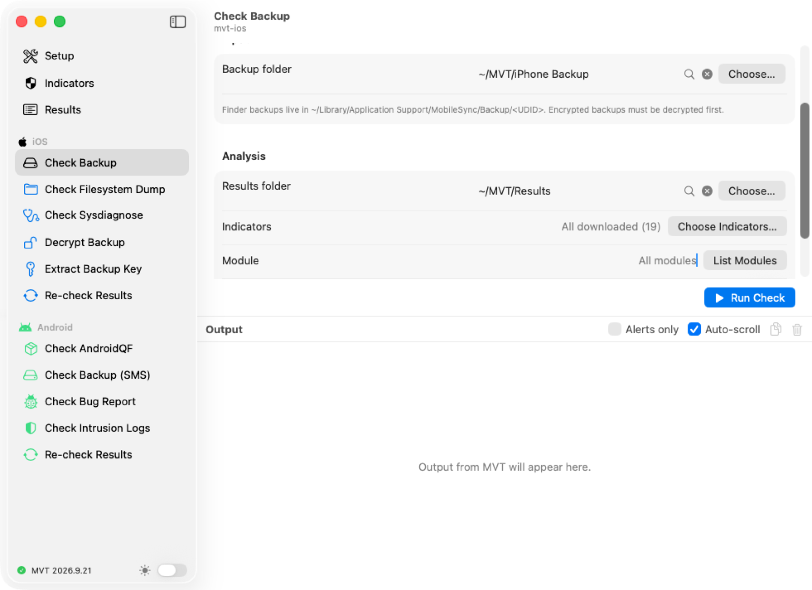
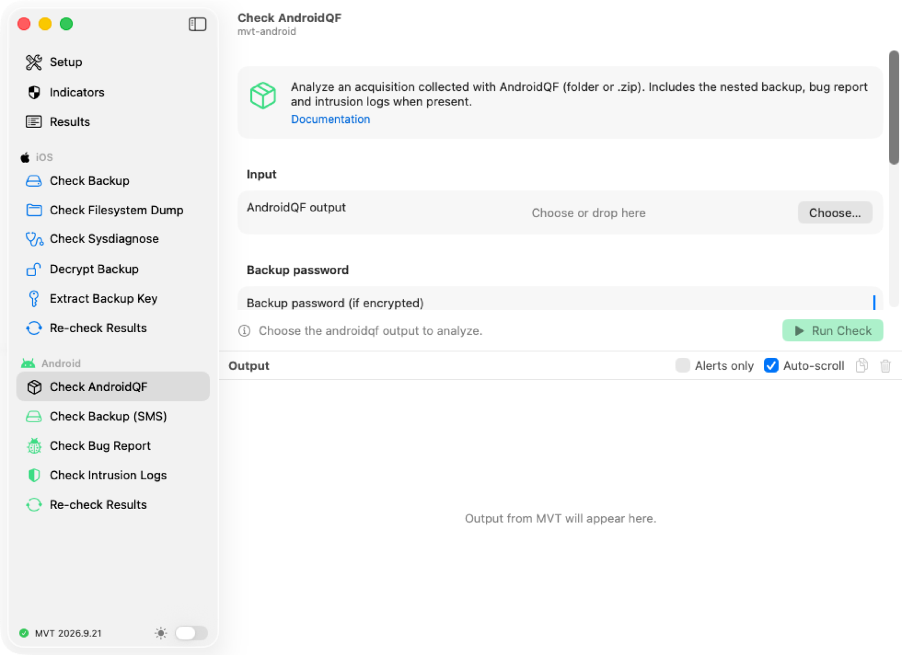
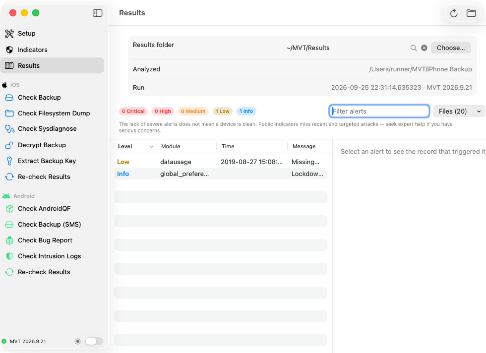

  <b>العربية</b> · <a href="README.md">English</a> · <a href="README.zh-CN.md">简体中文</a>

  

<h1 align="center">Telltrace</h1>

  <b>افحص أجهزة iPhone وهواتف Android بحثًا عن آثار برامج التجسس المعروفة.</b> 
  يعمل بمحرّك MVT، أي <a href="https://docs.mvt.re/">مجموعة أدوات التحقق من الأجهزة المحمولة</a>
  التي طوّرها مختبر الأمن في منظمة العفو الدولية. لا حاجة إلى سطر الأوامر.

  
  
  

  

## ⬇️ التنزيل

<table align="center">
  <tr>
    <th width="50%"> Mac</th>
    <th width="50%"> Windows</th>
  </tr>
  <tr>
    <td>macOS 13 Ventura أو أحدث، بمعالج Apple silicon</td>
    <td>Windows 10 أو 11، بنظام 64 بت</td>
  </tr>
  <tr>
    <td>
      <b>قريبًا على Mac App Store.</b> 
      يأتي MVT مدمجًا في التطبيق، ويتولى App Store تحديثه.
      لا يوجد تنزيل لنظام Mac هنا.
    </td>
    <td>
      1. نزّل <code>Telltrace-for-Windows-….zip</code> من
      <a href="https://github.com/Dream1Works/Telltrace/releases/latest">أحدث إصدار</a>. 
      2. فُكّ ضغطه في أي مكان: المستندات أو سطح المكتب أو ذاكرة USB. 
      3. انقر نقرًا مزدوجًا على <b>Telltrace.exe</b>. لا يُثبَّت أي شيء.
    </td>
  </tr>
</table>

إن أردت التأكد من أن الملف الذي نزّلته هو الأصلي، فطابِقه مع `SHA256SUMS.txt`
الموجود في صفحة إصداره.

## 🚀 البدء

1. لا شيء لتثبيته: MVT مدمج في كلا التطبيقين.
2. **Indicators** ← **Download All**. المؤشرات قوائم بآثار برامج التجسس المعروفة
   مصدرها [mvt-indicators](https://github.com/mvt-project/mvt-indicators)
   و[منظمة العفو الدولية](https://github.com/AmnestyTech/investigations)
   و[Echap](https://github.com/AssoEchap/stalkerware-indicators).
3. انسخ بيانات الهاتف احتياطيًا وشغّل فحصًا كما هو موضّح أدناه.

<b>📱 فحص iPhone</b>

1. وصّل iPhone بكابل، وافتح قفله، واضغط على **الوثوق** (Trust) إن طُلب منك ذلك.
2. أنشئ نسخة احتياطية مشفّرة:
   - **على Mac:** حدّد iPhone في Finder، وفعّل **تشفير النسخة الاحتياطية المحلية** (Encrypt local backup)،
     وعيّن كلمة مرور، ثم اضغط **نسخ احتياطي الآن** (Back Up Now).
   - **على Windows:** افتح **Back Up iPhone**، واختر مجلدًا، وأبقِ
     **Encrypt the backup** مفعّلًا، وعيّن كلمة مرور، ثم اضغط **Back Up**. يتطلب ذلك
     تثبيت تطبيق **Apple Devices** من Apple (أو iTunes).
3. افتح **Decrypt Backup**، واختر النسخة الاحتياطية واضغط **Decrypt**، ثم
   **Check Decrypted Backup**.
4. اختر **Results folder** (مجلد النتائج) واضغط **Run Check**.

إن كانت النسخ الاحتياطية لجهاز iPhone مشفّرة من قبل، فاستخدم كلمة المرور التي
عيّنتها حينها.

<b>🤖 فحص هاتف Android</b>

على الهاتف، فعّل **خيارات المطوّر** (Developer options): اضغط على **رقم الإصدار** (Build number)
سبع مرات في **الإعدادات ← حول الهاتف** (Settings → About phone).

**على Mac**، دون الحاجة إلى كابل:

1. في **خيارات المطوّر**، اضغط على **تقرير الأخطاء** (Take bug report)، ثم **تقرير كامل** (Full report).
2. عندما يُعلمك الهاتف بأن التقرير جاهز، اضغط على الإشعار وأرسل ملف ‎.zip
   إلى جهاز Mac (عبر AirDrop أو Quick Share أو كابل أو رسالة إلى نفسك).
3. افتح **Get a Bug Report**، واضغط **Check the Newest in Downloads**، ثم
   **Run Check**.

**على Windows**، باستخدام كابل:

1. في **خيارات المطوّر**، فعّل **تصحيح أخطاء USB** (USB debugging)، ووصّل الهاتف
   واسمح بتصحيح أخطاء USB لهذا الكمبيوتر.
2. افتح **Collect with AndroidQF**، واختر مجلدًا واضغط
   **Open AndroidQF**. يفتح في نافذة ويطرح عليك بضعة أسئلة.
3. عند الانتهاء، اضغط **Check the Newest Acquisition**، ثم **Run Check**.

<b>🔎 قراءة النتائج</b>

- تُرتَّب التنبيهات حسب الخطورة، من **Critical** (حرج) إلى **Info** (معلومات). انقر على أي تنبيه
  لمعرفة ما أطلقه.
- يعرض **Timeline** (الخط الزمني) كل حدث مؤرَّخ، مع تمييز الأحداث التي وقعت في وقت
  أي تنبيه.
- يحفظ **Export Report** تقريرًا بصيغة PDF أو صفحة ويب للاحتفاظ به، أو لإرساله إلى
  من يساعدك.

> **❗ مهم**
>
> **عدم ظهور تنبيهات لا يعني أن الهاتف سليم.** المؤشرات العامة لا تكشف الهجمات الجديدة
> والموجّهة. إن كان لديك قلق، فاطلب مساعدة الخبراء من
> [مختبر الأمن في منظمة العفو الدولية](https://securitylab.amnesty.org/get-help/?c=mvt_docs)
> أو [خط المساعدة للأمن الرقمي من Access Now](https://www.accessnow.org/help/).
> لا تفحص هاتفًا إلا بموافقة صاحبه.

## ✨ ما بداخله

| | |
|---|---|
| 📲 **الحصول على البيانات بسهولة** | افحص هاتف Android من تقرير أخطاء ينشئه بنفسه (Mac)، أو انسخ iPhone احتياطيًا واجمع بيانات Android من داخل التطبيق (Windows). |
| 🧭 **فحوصات موجَّهة** | كل فحوصات MVT في نماذج بسيطة، مع مخرجات مباشرة ملوّنة. |
| 🛡️ **مؤشرات محدَّثة** | ينبّهك عندما يمضي أسبوع على المؤشرات، ويمكنه تحديثها قبل كل فحص. |
| 📊 **نتائج واضحة** | تنبيهات حسب الخطورة، وخط زمني، وتقرير لمشاركته. |
| 🔔 **لا يزعجك** | إشعار عند انتهاء فحص طويل. |
| 🌗 **فاتح وداكن** | يتبع نظامك، أو اختر ما تفضّله. |

<b>🪟 المزيد عن تطبيق Windows</b>

- يبدأ التطبيق عبر مشغّل Python الرسمي الموقَّع، لذا لا يحظره Windows Security
  ولا SmartScreen.
- MVT مضمَّن. عند صدور إصدار أحدث من MVT، يعرض **Setup** خيار **Update MVT**.
- تُحفظ الإعدادات والمؤشرات في مجلد `Data` داخل مجلد التطبيق. لإزالة
  التطبيق، احذف المجلد.
- يشرح ملف `README.txt` الموجود في المجلد التعامل مع Smart App Control والوصول المتحكَّم فيه
  إلى المجلدات.

## ❤️ الدعم

إن كان Telltrace مفيدًا لك، فيمكنك دعمه على
[Patreon](https://patreon.com/Dossary) أو [Ko-fi](https://ko-fi.com/2b4g10/10).
وجدت مشكلة أمنية؟ راجع [SECURITY.md](.github/SECURITY.md).

## 📄 الرخصة

حقوق النشر © 2026 لـ 2B-4G10 في Telltrace، وهو مرخَّص بموجب
[اتفاقية ترخيص المستخدم النهائي لـ Telltrace](EULA.md). تحتفظ الإصدارات السابقة
بالرخصة التي صدرت بها.

حقوق النشر © 2021-2026 لمؤلفي MVT (The MVT Authors) في MVT، المحرّك الذي يعمل داخل التطبيق، بموجب
[رخصة MVT 1.1](LICENSE-MVT)، وشيفرته المصدرية متاحة في
[mvt-project/mvt](https://github.com/mvt-project/mvt). تجد إشارات الفضل للأعمال الفنية
والعلامات التجارية في [NOTICE](NOTICE)، ويسرد تنزيل Windows رخصة كل
مكوّن مضمَّن فيه داخل `THIRD-PARTY-NOTICES.txt`.

Telltrace (الذي كان اسمه MVT GUI قبل الإصدار 4.0.3) تطبيق مستقل، ولا
يرتبط بمنظمة العفو الدولية أو مشروع MVT، ولا يحظى بتأييدهما.

من صنع <a href="https://github.com/2B-4G10">2B-4G10</a>

