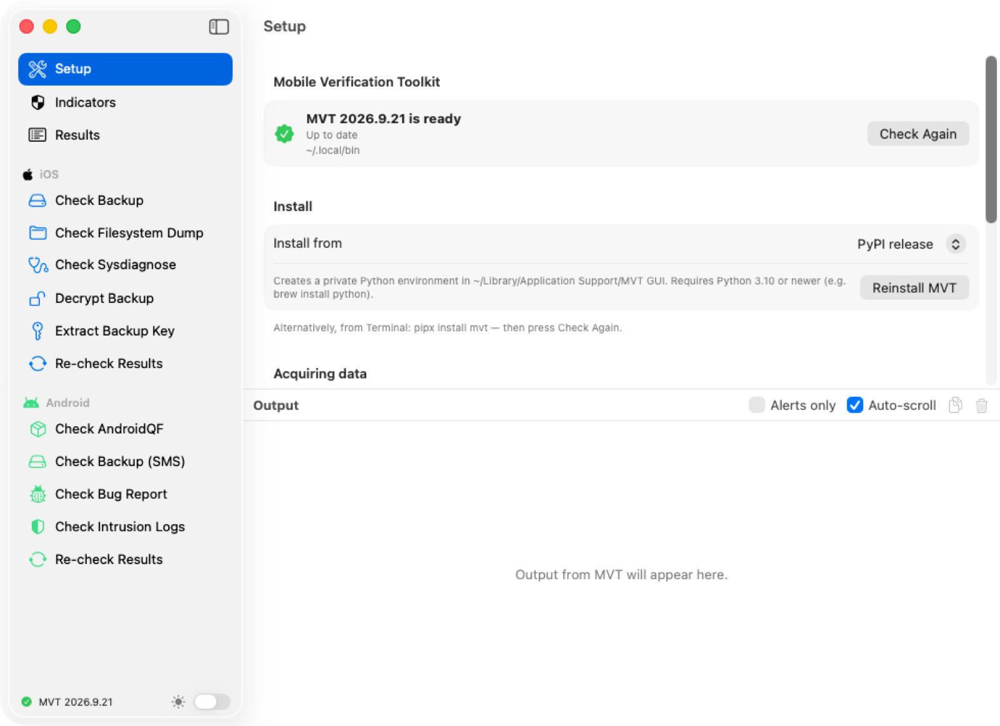
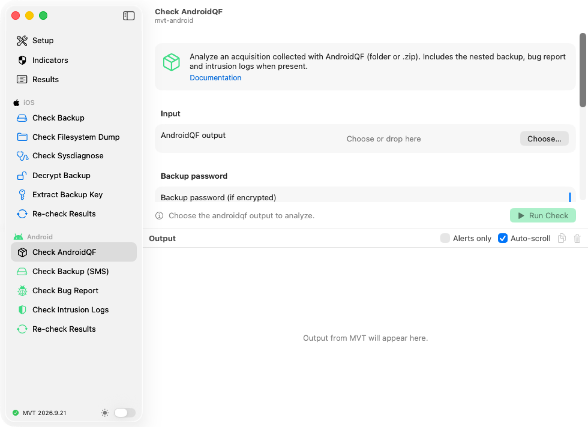
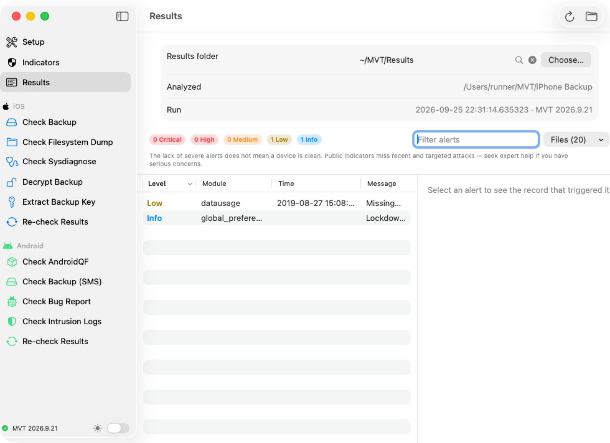

<p align="center">
  
</p>

<h1 align="center">MVT GUI</h1>

<p align="center">
  <b>Check iPhones and Android phones for traces of known spyware.</b><br>
  A friendly Mac and Windows app for Amnesty International's
  <a href="https://docs.mvt.re/">Mobile Verification Toolkit</a>. No Terminal needed.
</p>

<p align="center">
  <a href="https://github.com/Dream1Works/MVT-GUI/releases/latest"></a>
  <a href="https://github.com/Dream1Works/MVT-GUI/releases"></a>
  <a href="EULA.md"></a>
</p>

<p align="center">
  
</p>

## ⬇️ Download

<table align="center">
  <tr>
    <th width="50%"> Mac</th>
    <th width="50%"> Windows</th>
  </tr>
  <tr>
    <td>macOS 13 Ventura or newer</td>
    <td>Windows 10 or 11, 64-bit</td>
  </tr>
  <tr>
    <td>
      1. Download <code>MVT-GUI-…-macOS.zip</code> from
      <a href="https://github.com/Dream1Works/MVT-GUI/releases/latest">the latest release</a>.<br>
      2. Unzip it and move <b>MVTGUI.app</b> to <b>Applications</b>.<br>
      3. First time only: right-click the app, choose <b>Open</b>, then <b>Open</b> again.
    </td>
    <td>
      1. Download <code>MVT-for-Windows-….zip</code> from
      <a href="https://github.com/Dream1Works/MVT-GUI/releases/latest">the latest release</a>.<br>
      2. Unzip it anywhere: Documents, the Desktop or a USB drive.<br>
      3. Double-click <b>MVT for Windows.exe</b>. Nothing is installed.
    </td>
  </tr>
</table>

Prefer [Homebrew](https://brew.sh) on a Mac?

```sh
brew tap dream1works/mvt-gui https://github.com/Dream1Works/MVT-GUI
brew install --cask mvt-gui
```

Check a download against `SHA256SUMS.txt` in its release if you want to be
sure it is the real one.

## 🚀 Get started

1. **Mac:** **Setup** → **Install MVT** (Python comes with the app).
   **Windows:** nothing to do, MVT is included.
2. **Indicators** → **Download All**. Indicators are lists of known spyware
   traces from [mvt-indicators](https://github.com/mvt-project/mvt-indicators),
   [Amnesty International](https://github.com/AmnestyTech/investigations) and
   [Echap](https://github.com/AssoEchap/stalkerware-indicators).
3. Back up the phone and run a check, as below.

<details>
<summary><b>📱 Check an iPhone</b></summary>

1. Connect the iPhone with a cable, unlock it, and tap **Trust** if it asks.
2. Open **Back Up iPhone**, choose a folder, keep **Encrypt the backup** on,
   set a password and press **Back Up**.
3. Press **Decrypt Backup**, then **Decrypt**, then **Check Decrypted Backup**.
4. Choose a **Results folder** and press **Run Check**.

A backup you made yourself with Finder, iTunes or the Apple Devices app
works too: start at step 3. If the iPhone's backups were already encrypted,
use the password you set back then. On Windows, **Back Up iPhone** needs
Apple's **Apple Devices** app (or iTunes) installed.

<p align="center"></p>
</details>

<details>
<summary><b>🤖 Check an Android phone</b></summary>

1. On the phone, turn on **Developer options** (tap **Build number** seven
   times in **Settings → About phone**), then **USB debugging**.
2. Connect it with a cable and allow USB debugging for this computer.
3. Open **Collect with AndroidQF**, choose a folder and press
   **Open AndroidQF**. It opens in a window and asks a few questions.
4. When it's done, press **Check the Newest Acquisition**, then **Run Check**.

<p align="center"></p>
</details>

<details>
<summary><b>🔎 Read the results</b></summary>

- Alerts are sorted by severity, from **Critical** to **Info**. Click one to
  see what triggered it.
- **Timeline** shows every dated event, with the ones at the time of an
  alert highlighted.
- **Export Report** saves a PDF or web page to keep, or to send to someone
  who helps you.

<p align="center"></p>
</details>

> [!IMPORTANT]
> **No alerts doesn't mean a phone is clean.** Public indicators miss new
> and targeted attacks. If you're worried, get expert help from
> [Amnesty International's Security Lab](https://securitylab.amnesty.org/get-help/?c=mvt_docs)
> or [Access Now's Digital Security Helpline](https://www.accessnow.org/help/).
> Only check a phone with the consent of its owner.

## ✨ What's inside

| | |
|---|---|
| 📲 **Back up from the app** | Back up an iPhone or collect from an Android phone without other tools. |
| 🧭 **Guided checks** | Every MVT check as a simple form, with live, color-coded output. |
| 🛡️ **Fresh indicators** | Warns when indicators are a week old, and can update them before each check. |
| 📊 **Clear results** | Alerts by severity, a timeline, and a report to share. |
| 🔔 **Stays out of the way** | A notification when a long check ends, and a note when a new version is out. |
| 🌗 **Light and dark** | Follows your system, or pick one. |

<details>
<summary><b>🪟 More about the Windows app</b></summary>

- It starts through Python's own signed launcher, so Windows Security and
  SmartScreen don't block it.
- MVT is included. When a newer MVT is out, **Setup** offers **Update MVT**.
- Settings and indicators live in the app folder's `Data` folder. To remove
  the app, delete the folder.
- `README.txt` in the folder covers Smart App Control and controlled folder
  access.
</details>

## ❤️ Support

If MVT GUI helps you, you can support it on
[Patreon](https://patreon.com/Dossary) or [Ko-fi](https://ko-fi.com/2b4g10/10).
Found a security problem? See [SECURITY.md](.github/SECURITY.md).

## 📄 License

MVT GUI is Copyright © 2026 2B-4G10, licensed under the
[MVT GUI End User License Agreement](EULA.md). Earlier versions keep the
license they were released under.

MVT, the engine inside, is Copyright © 2021-2026 The MVT Authors under the
[MVT License 1.1](LICENSE-MVT); its source is at
[mvt-project/mvt](https://github.com/mvt-project/mvt). Credits for artwork
and trademarks are in [NOTICE](NOTICE), and the Windows download lists every
bundled component's license in `THIRD-PARTY-NOTICES.txt`.

<p align="center"><sub>Made by <a href="https://github.com/2B-4G10">2B-4G10</a></sub></p>
