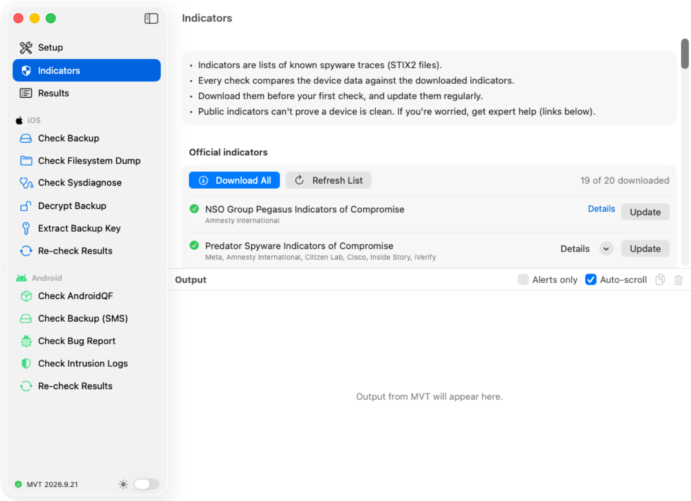
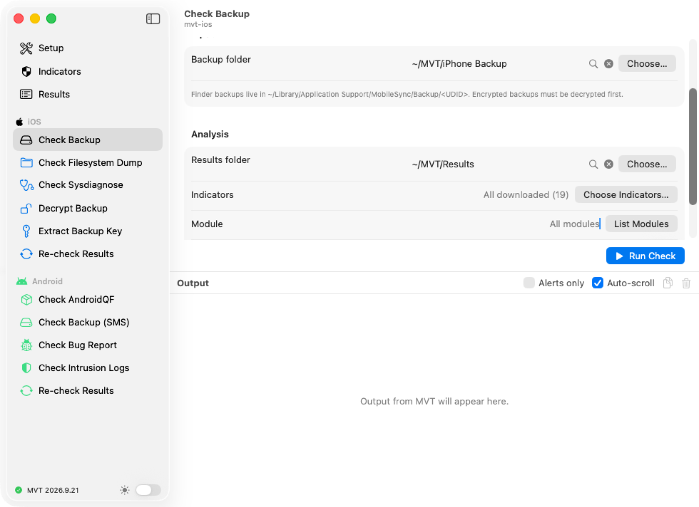

<p align="center">
  
</p>

<h1 align="center">MVT Graphical UI</h1>

<p align="center">
  Check iPhones and Android phones for traces of known spyware, without the Terminal!
</p>

<p align="center">
  <a href="https://github.com/2B-4G10/MVT-GUI/releases/latest"></a>
  <a href="#get-the-app"></a>
  <a href="#windows"></a>
</p>

<p align="center">
  <a href="https://github.com/2B-4G10/MVT-GUI/releases"></a>
  <a href="https://github.com/2B-4G10/MVT-GUI/releases"></a>
  <a href="https://github.com/2B-4G10/MVT-GUI/releases"></a>
  <a href="https://github.com/2B-4G10/MVT-GUI/releases/latest"></a>
</p>

<p align="center">
  <a href="https://github.com/2B-4G10/MVT-GUI/releases/latest"></a>
  <a href="https://pypi.org/project/mvt/"></a>
</p>

<p align="center">
  <a href="https://github.com/2B-4G10/MVT-GUI/releases/latest"></a>
  <a href="https://github.com/2B-4G10/MVT-GUI/stargazers"></a>
  <a href="EULA.md"></a>
</p>

**MVT GUI** is a simple app for the
[Mobile Verification Toolkit (MVT)](https://docs.mvt.re/) by Amnesty
International's Security Lab.

## Supported systems

<div align="center">
<table>
  <tr><th></th><th>System</th><th>Status</th><th>How</th></tr>
  <tr>
    <td></td>
    <td><b>Windows</b> 10 and 11 (64-bit)</td>
    <td align="center">✅</td>
    <td>Portable app, MVT included (<a href="#windows">see below</a>)</td>
  </tr>
  <tr>
    <td></td>
    <td><b>macOS</b> 13 Ventura or newer</td>
    <td align="center">✅</td>
    <td>Mac app (<a href="#get-the-app">Get the app</a>)</td>
  </tr>
  <tr>
    <td></td>
    <td><b>Linux</b></td>
    <td align="center">❌</td>
    <td>Not supported yet</td>
  </tr>
</table>
</div>

<p align="center">
  
</p>

##  Get the app

1. Download the latest `MVT-GUI-…-macOS.zip` from
   [Releases](https://github.com/2B-4G10/MVT-GUI/releases).
2. Unzip it and move **MVTGUI.app** from the new folder to your
   **Applications** folder.
3. The first time only: right-click the app, choose **Open**, then **Open**
   again. The app isn't notarized by Apple.

You need macOS 13 Ventura or newer. Python comes with the app, so
**Install MVT** needs nothing else.

Or install it with [Homebrew](https://brew.sh):

```sh
brew tap 2b-4g10/mvt-gui https://github.com/2B-4G10/MVT-GUI
brew install --cask mvt-gui
```

##  Windows

There's also a portable app for Windows 10 and 11 (64-bit), with MVT
included:

1. Download the latest `MVT-for-Windows-….zip` from
   [Releases](https://github.com/2B-4G10/MVT-GUI/releases).
2. Unzip it into Documents, your Desktop or a USB drive.
3. Open the **MVT for Windows** folder and double-click
   **MVT for Windows.exe**. Nothing is installed, and no administrator
   rights are needed. To remove it, delete the folder.

The app starts through Python's own signed launcher, so Windows Security
and SmartScreen don't block it. MVT is already installed: skip **Install
MVT** below. When a newer MVT is out, **Setup** offers **Update MVT**.
Settings and indicators are kept in the folder's `Data` folder.

Everything else works as described below. **Back Up iPhone** needs Apple's
**Apple Devices** app (or iTunes) installed, so Windows can see the iPhone.
Backups made with the Apple Devices app itself are saved in
`%USERPROFILE%\Apple\MobileSync\Backup` or
`%APPDATA%\Apple Computer\MobileSync\Backup`. AndroidQF has a Windows
version. `README.txt` in the folder covers Smart App Control and
controlled folder access.

## Set it up (once)

1. Open **Setup** and press **Install MVT**.
   - If MVT is already installed, the app finds it.
   - If your MVT is out of date, press **Update MVT**.
2. Open **Indicators** and press **Download All**.

<p align="center">
  
</p>

Indicators are lists of known spyware traces. The app downloads them from
the official sources:
[mvt-indicators](https://github.com/mvt-project/mvt-indicators),
[Amnesty International](https://github.com/AmnestyTech/investigations) and
[Echap's stalkerware indicators](https://github.com/AssoEchap/stalkerware-indicators).
Download them again from time to time to stay current.

## Check an iPhone

1. Connect the iPhone with a cable, unlock it, and tap **Trust** if it asks.
2. In the app, open **Back Up iPhone**, choose a folder, keep **Encrypt
   the backup** on, set a password and press **Back Up**. The first time,
   the app installs [pymobiledevice3](https://github.com/doronz88/pymobiledevice3),
   which makes the backup.
3. Press **Decrypt Backup**. The backup and your password are filled in:
   press **Decrypt**, then **Check Decrypted Backup**.
4. Choose a **Results folder** and press **Run Check**.

A backup made by Finder (tick **Encrypt local backup**, then **Back Up
Now**) works too: it is in `~/Library/Application Support/MobileSync/Backup/`.
Start from step 3 with **Decrypt Backup**. If the iPhone's backups were
already encrypted, the password set back then is the one to use.

<p align="center">
  
</p>

## Check an Android phone

1. On the phone, turn on **Developer options** (tap **Build number** seven
   times in **Settings → About phone**), then **USB debugging**. Connect it
   with a cable and allow USB debugging for the computer.
2. In the app, open **Collect with AndroidQF**, choose a folder and press
   **Open AndroidQF**. The app downloads
   [AndroidQF](https://github.com/mvt-project/androidqf), checks it, and
   opens it in a Terminal (or console) window, where it asks a few
   questions.
3. When it's done, press **Check the Newest Acquisition**.
4. Choose a **Results folder** and press **Run Check**.

<p align="center">
  
</p>

## Read the results

1. Press **View Results** when the check finishes, or open **Results** and
   choose the results folder.
2. Alerts are sorted by severity: **Critical**, **High**, **Medium**,
   **Low**, **Info**.
3. Click an alert to see what triggered it.
4. **Timeline** lists every dated event the check found, with the ones at
   the time of an alert highlighted.
5. **Export Report** saves a PDF or web page of the check to keep or send
   to someone who helps you.

<p align="center">
  
</p>

> **No alerts doesn't mean a phone is clean.** Public indicators miss new
> and targeted attacks. If you're worried, get expert help from
> [Amnesty International's Security Lab](https://securitylab.amnesty.org/get-help/?c=mvt_docs)
> or [Access Now's Digital Security Helpline](https://www.accessnow.org/help/).

## Tips

- **Choose Indicators…** in any check lets you use all indicators, only the
  ones you pick, or your own STIX2 files.
- **Re-check Results** compares old results against newer indicators,
  without the phone.
- Indicators older than a week are flagged. **Settings → Update indicators
  before each check** keeps them current for you.
- A long check that finishes while the app is in the background ends with
  a notification.
- When a newer version of the app is out, the sidebar and **Setup** say so.
- The switch at the bottom of the sidebar turns dark mode on or off.
  **Settings → Appearance** can also follow your Mac's setting.

## Support the project

If MVT GUI helps you, you can show your love on
[Patreon](https://patreon.com/Dossary) ❤️ or [Ko-fi](https://ko-fi.com/2b4g10/10) ☕

## License

MVT GUI (the Mac and Windows apps) is Copyright © 2026 2B-4G10. All rights
reserved. It is proprietary software, licensed under the
[MVT GUI End User License Agreement](EULA.md). Earlier versions keep the
license they were released under (see the EULA).

MVT, the engine the apps run, is Copyright © 2021-2026 The MVT Authors and
stays under the [MVT License 1.1](LICENSE-MVT); its source code is at
[mvt-project/mvt](https://github.com/mvt-project/mvt). Both only allow
checking a phone with the consent of its owner or user. Credits for
third-party artwork and trademarks are in [NOTICE](NOTICE). The Windows
download lists the license of every component it bundles (Python, Qt,
PySide6 and MVT's Python packages) in `THIRD-PARTY-NOTICES.txt`.
