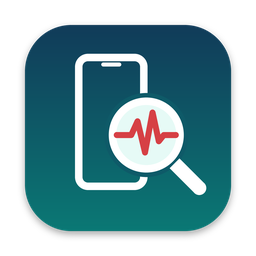
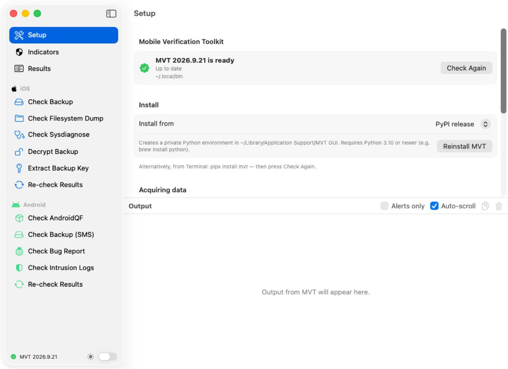
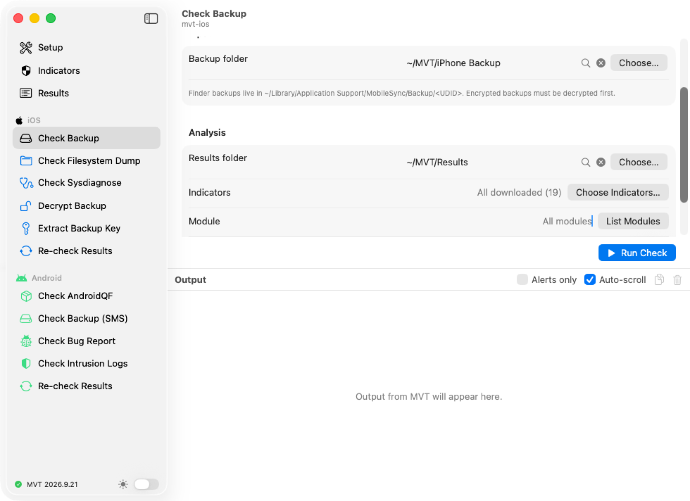
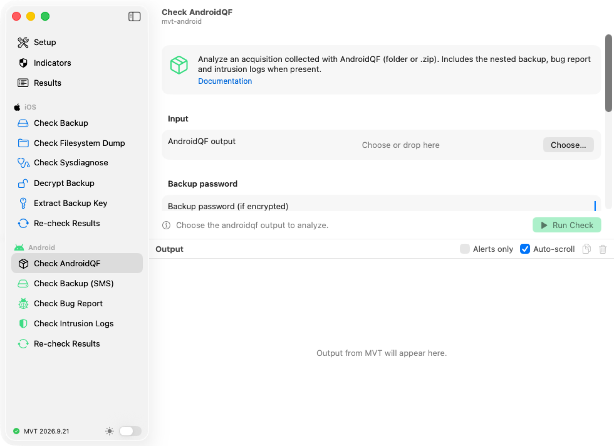
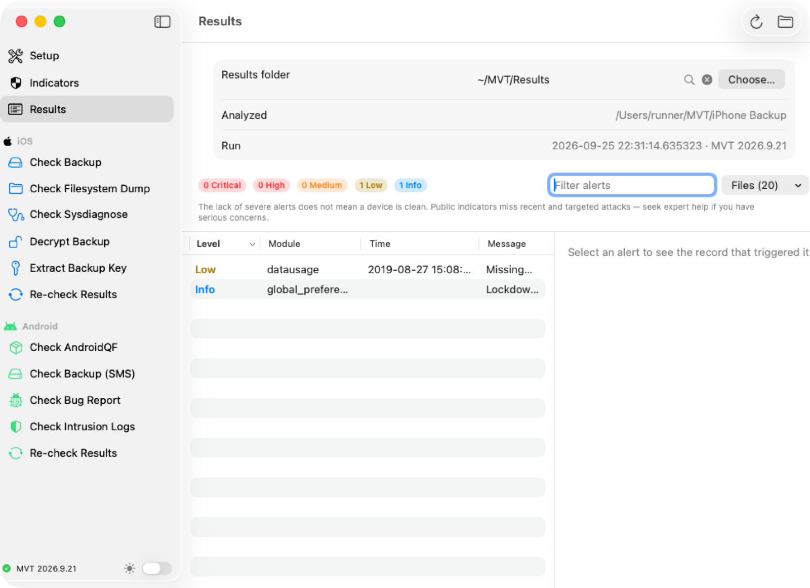

  <a href="README.ar.md">العربية</a> · <a href="README.md">English</a> · <b>简体中文</b>

  

<h1 align="center">Telltrace</h1>

  <b>检查 iPhone 和 Android 手机中是否有已知间谍软件的痕迹。</b> 
  基于 MVT，即国际特赦组织安全实验室开发的<a href="https://docs.mvt.re/">移动设备验证工具包</a>。
  无需使用终端。

  
  
  

  

## ⬇️ 下载

<table align="center">
  <tr>
    <th width="50%"> Mac</th>
    <th width="50%"> Windows</th>
  </tr>
  <tr>
    <td>macOS 13 Ventura 或更高版本，Apple silicon 芯片</td>
    <td>Windows 10 或 11，64 位</td>
  </tr>
  <tr>
    <td>
      <b>即将登陆 Mac App Store。</b> 
      应用内置 MVT，并由 App Store 保持更新。
      此处不提供 Mac 版下载。
    </td>
    <td>
      1. 从<a href="https://github.com/Dream1Works/Telltrace/releases/latest">最新版本</a>下载
      <code>Telltrace-for-Windows-….zip</code>。 
      2. 解压到任意位置：文档、桌面或 U 盘均可。 
      3. 双击 <b>Telltrace.exe</b>。无需安装任何内容。
    </td>
  </tr>
</table>

如果想确认下载的文件是正版，可以用其发布页中的 `SHA256SUMS.txt`
进行核对。

## 🚀 快速上手

1. 无需安装：两个应用都已内置 MVT。
2. **Indicators** → **Download All**。指标是已知间谍软件痕迹的列表，
   来自 [mvt-indicators](https://github.com/mvt-project/mvt-indicators)、
   [国际特赦组织](https://github.com/AmnestyTech/investigations)和
   [Echap](https://github.com/AssoEchap/stalkerware-indicators)。
3. 备份手机并运行检查，步骤如下。

<b>📱 检查 iPhone</b>

1. 用数据线连接 iPhone 并解锁，如有提示，请轻点**信任**（Trust）。
2. 创建加密备份：
   - **Mac：** 在“访达”（Finder）中选择 iPhone，勾选**加密本地备份**（Encrypt local backup），
     设置密码，然后点击**立即备份**（Back Up Now）。
   - **Windows：** 打开 **Back Up iPhone**，选择一个文件夹，保持
     **Encrypt the backup** 开启，设置密码，然后点击 **Back Up**。需要安装
     Apple 的 **Apple Devices** 应用（或 iTunes）。
3. 打开 **Decrypt Backup**，选择备份并点击 **Decrypt**，然后点击
   **Check Decrypted Backup**。
4. 选择 **Results folder**（结果文件夹），然后点击 **Run Check**。

如果这台 iPhone 的备份之前就已加密，请使用当时设置的密码。

<b>🤖 检查 Android 手机</b>

在手机上开启**开发者选项**（Developer options）：在**设置 → 关于手机**（Settings → About phone）中
连续轻点**版本号**（Build number）七次。

**Mac**，无需数据线：

1. 在**开发者选项**中轻点**提交错误报告**（Take bug report），然后选择**完整报告**（Full report）。
2. 手机提示报告已就绪后，轻点通知，将 .zip 文件发送到 Mac
   （可通过 AirDrop、Quick Share、数据线或发消息给自己）。
3. 打开 **Get a Bug Report**，点击 **Check the Newest in Downloads**，然后点击
   **Run Check**。

**Windows**，需要数据线：

1. 在**开发者选项**中开启 **USB 调试**（USB debugging），连接手机，
   并允许这台电脑进行 USB 调试。
2. 打开 **Collect with AndroidQF**，选择一个文件夹，然后点击
   **Open AndroidQF**。它会在一个窗口中打开，并询问几个问题。
3. 完成后，点击 **Check the Newest Acquisition**，然后点击 **Run Check**。

<b>🔎 查看结果</b>

- 警报按严重程度排序，从 **Critical**（严重）到 **Info**（信息）。点击任一警报
  即可查看触发原因。
- **Timeline**（时间线）显示所有带日期的事件，并突出显示警报发生时
  的事件。
- **Export Report** 可将报告保存为 PDF 或网页，供自己留存，或发送给
  帮助你的人。

> [!IMPORTANT]
> **没有警报并不代表手机是干净的。** 公开的指标无法发现新型攻击
> 和定向攻击。如果你感到担心，请向
> [国际特赦组织安全实验室](https://securitylab.amnesty.org/get-help/?c=mvt_docs)
> 或 [Access Now 数字安全求助热线](https://www.accessnow.org/help/)寻求专家帮助。
> 请仅在手机所有者同意的情况下检查手机。

## ✨ 功能一览

| | |
|---|---|
| 📲 **轻松获取数据** | 通过 Android 手机自己生成的错误报告进行检查（Mac），或在应用内备份 iPhone 并采集 Android 数据（Windows）。 |
| 🧭 **引导式检查** | 每项 MVT 检查都是一个简单的表单，并实时显示彩色输出。 |
| 🛡️ **及时更新的指标** | 指标超过一周未更新时会提醒你，并可在每次检查前自动更新。 |
| 📊 **清晰的结果** | 按严重程度排列的警报、时间线以及可分享的报告。 |
| 🔔 **不打扰你** | 长时间检查结束时发送通知。 |
| 🌗 **浅色与深色** | 跟随系统设置，也可自行选择。 |

<b>🪟 关于 Windows 应用的更多信息</b>

- 它通过 Python 官方签名的启动器运行，因此不会被 Windows 安全中心
  和 SmartScreen 拦截。
- 已内置 MVT。有新版 MVT 时，**Setup** 会提供 **Update MVT**。
- 设置和指标保存在应用文件夹内的 `Data` 文件夹中。要移除
  应用，删除该文件夹即可。
- 文件夹中的 `README.txt` 介绍了智能应用控制（Smart App Control）和受控文件夹
  访问的相关说明。

## ❤️ 支持

如果 Telltrace 对你有帮助，欢迎在
[Patreon](https://patreon.com/Dossary) 或 [Ko-fi](https://ko-fi.com/2b4g10/10) 上支持它。
发现安全问题？请参阅 [SECURITY.md](.github/SECURITY.md)。

## 📄 许可证

Telltrace 版权所有 © 2026 2B-4G10，依据
[Telltrace 最终用户许可协议](EULA.md)授权。早期版本仍沿用其发布时
的许可证。

MVT 是 Telltrace 内置的引擎，版权所有 © 2021-2026 The MVT Authors，依据
[MVT 许可证 1.1](LICENSE-MVT) 授权；其源代码位于
[mvt-project/mvt](https://github.com/mvt-project/mvt)。美术作品和商标的致谢信息
见 [NOTICE](NOTICE)，Windows 下载包中的 `THIRD-PARTY-NOTICES.txt`
列出了每个捆绑组件的许可证。

Telltrace（4.0.3 版本之前名为 MVT GUI）是一款独立应用，与国际特赦组织
或 MVT 项目没有任何关联，也未获得其认可。

由 <a href="https://github.com/2B-4G10">2B-4G10</a> 制作

